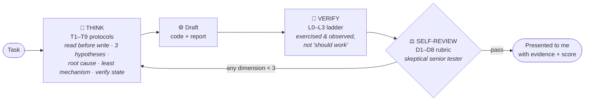

# my_claude_efficiency

> How I get senior-level output from Claude Code on every project — written **with Claude Fable 5, for whatever model comes after it.**

Model tiers change. My quality bar doesn't. So while I had the strongest model available, I made it write down two things: everything it *knows* about working on my projects, and — more importantly — *how it thinks*. A weaker model reading these files doesn't get smarter, but it starts behaving like a disciplined senior instead of an eager junior. That covers most of the gap.

## The core loop

Layer 2 in one picture — every substantial piece of work passes through this before I ever see it:

The model grades its own output like a suspicious reviewer and loops back **before** presenting — failures get caught while they're still free to fix.

## Layer 2 — cognition protocols *(the part that actually matters)*

Project-independent thinking procedures. This is the distilled part: the habits a stronger model performs unprompted, converted into steps any model can follow mechanically.

| File | What it forces | When it runs |
|---|---|---|
| [THINKING_PROTOCOLS.md](THINKING_PROTOCOLS.md) | T1–T9: read-before-write, 3-hypothesis debugging, root-cause gate, altitude check, least mechanism, assumption ledger, edge-case grid, constraint refresh, verify-state-before-acting | During the work |
| [VERIFICATION_PROTOCOL.md](VERIFICATION_PROTOCOL.md) | Definition of done in levels L0–L3, evidence tables with pasted output, regression sweeps, Verified/Assumed/Unknown reporting — bans "should work" | Before claiming "done" |
| [FABLE_BAR_RUBRIC.md](FABLE_BAR_RUBRIC.md) | Self-review as a skeptical senior tester: 8 graded dimensions, a smell list, a pass bar, fix-before-present loop | Before I see anything |

**Activation:** these only work if they enter the model's context. I paste the loading paragraph (bottom of THINKING_PROTOCOLS.md) into each project's `CLAUDE.md` — that hook makes every session read and obey them automatically, without me remembering to ask.

## Layer 1 — context guides

General rules and background. Each guide teaches how to build one per-project "brain file", with anti-patterns and a copy-paste template. These give a model *knowledge of my project*; layer 2 gives it *judgment*.

| # | Guide | Produces (per project) | Protects |
|---|---|---|---|
| 1 | [CLAUDE_MD_GUIDE.md](CLAUDE_MD_GUIDE.md) | `CLAUDE.md` | The present: commands, map, landmines, my rules |
| 2 | [DECISIONS_GUIDE.md](DECISIONS_GUIDE.md) | `docs/DECISIONS.md` | The past: choices + rejected alternatives |
| 3 | [PATTERNS_GUIDE.md](PATTERNS_GUIDE.md) | `docs/PATTERNS.md` | Paid lessons: proven fixes, disproven attempts |
| 4 | [SKILLS_GUIDE.md](SKILLS_GUIDE.md) | `.claude/skills/*/SKILL.md` | Repeating workflows as executable recipes |
| 5 | [REVIEW_CHECKLIST_GUIDE.md](REVIEW_CHECKLIST_GUIDE.md) | `docs/REVIEW-CHECKLIST.md` | The quality bar, frozen into binary checks |
| 6 | [ROADMAP_GUIDE.md](ROADMAP_GUIDE.md) | `docs/ROADMAP.md` | The future: direction, deferrals, anti-goals |

## How I roll it out on a project

0. **Layer 2 hook first** — paste the loading paragraph into the project's `CLAUDE.md`. Zero mining, immediate effect on every session after.
1. `CLAUDE.md` — highest leverage, auto-loaded every session.
2. `PATTERNS.md` — mine my session reports for every bug that took 2+ iterations.
3. `DECISIONS.md` — mine session reports + meeting notes for decisions that had real alternatives.
4. `ROADMAP.md` — one planning pass.
5. `REVIEW-CHECKLIST.md` — copy the master list, add the project-specific section.
6. Skills — last; they depend on the rules the other files pin down.

## What this buys (honestly)

Layer 1 closes the **context gap**: the model stops relitigating my decisions, re-hitting solved bugs, and breaking my workflow rules. Layer 2 closes the **discipline gap**: no more first-idea fixes, unverified "done ✅" claims, symptom patches, or happy-path testing — which is most of the day-to-day difference between model tiers. What no file transfers: raw insight on genuinely novel problems. Everything short of that is transferable — and these files are the transfer.

## The whole method in one line

> Strong models have taste and judgment; weak models follow instructions well. Distillation = converting taste into instructions **while the strong model is still here.**

